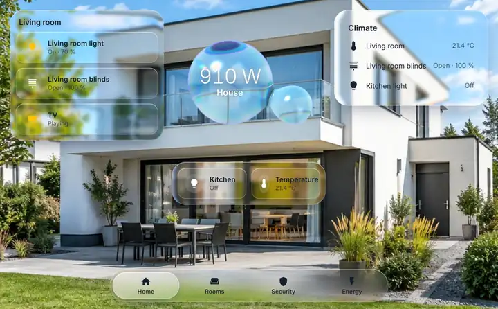
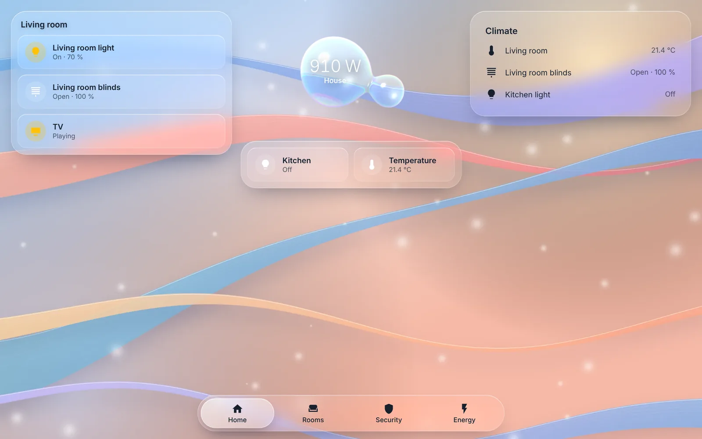
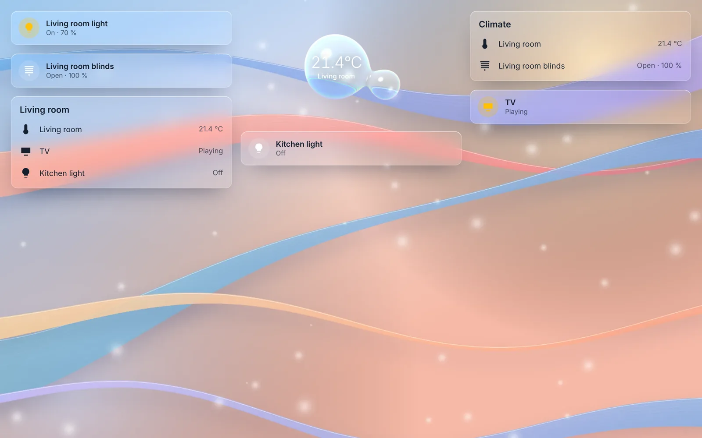
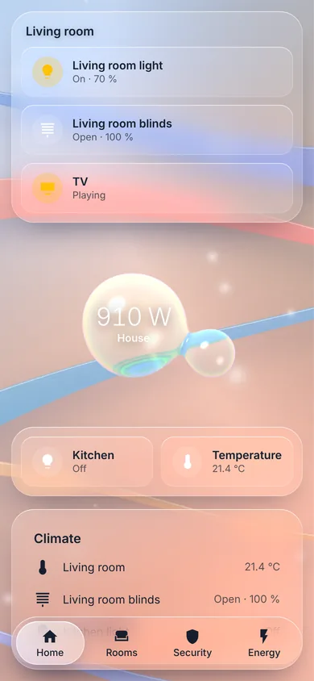

# Fluid Glass Cards

Glass for any Home Assistant dashboard: frames with real refraction around your existing cards,
draggable glass drops that show a value, a glass navigation bar with a sliding drop, and a one-line
switch that turns every card of a view into glass.



| Frame, drop and navigation | Whole view in glass | Phone |
|---|---|---|
|  |  |  |

Works with the cards you already use (tile, entities, Mushroom and others). No build step,
no dependencies, one file.

## Installation

**Marketplace / HACS:** search for *Fluid Glass Cards* and download it.

**Manual:** copy `dist/fluid-glass-cards.js` to `config/www/` and add it as a dashboard resource:
`/local/fluid-glass-cards.js`, type *JavaScript module*.

Glass needs something behind it. Give the view a background picture, for example in the view's
raw configuration:

```yaml
background:
  image: /local/background.jpg
  attachment: fixed
```

or let `fluid-glass-view` set it (see below).

## The cards

### Glass frame – `custom:fluid-glass-card`

Puts any cards into one glass frame. The edges bend the picture behind them like a lens, the cards
inside become glass tiles, and everything gives way when pressed and springs back.

```yaml
type: custom:fluid-glass-card
title: Living room
cards:
  - type: tile
    entity: light.living_room
  - type: tile
    entity: cover.living_room
```

| Option | Default | What it does |
|---|---|---|
| `cards` | required | the cards inside the frame |
| `title` | – | heading at the top of the frame |
| `layout` | `vertical` | `vertical`, `horizontal` or `grid` |
| `columns` | `2` | columns for `layout: grid` |
| `inner` | `glass` | `glass` turns the inner cards into glass tiles, `clear` makes them transparent |
| `tint` | `none` | `amber`, `blue`, `violet`, `green`, `rose`, `cyan`, `orange` or `"r,g,b"` |
| `radius` | `28` | corner radius of the frame in px |
| `padding` | `12` | space inside the frame in px |
| `gap` | `10` | space between the inner cards in px |
| `blur` | `14` | blur of the glass in px |
| `strength` | `1` | strength of the refraction (0.5 to 2.5) |
| `refraction` | `true` | set `false` on slow wall tablets: frosted glass only |
| `press` | `true` | elastic press effect |

### Glass drop – `custom:fluid-glass-drop-card`

Two glass drops that refract the background of the view. The large one shows the value of an
entity; tap it for the more-info dialog. Drag or flick the drops, pull them together and they merge.
They stay where you leave them.

```yaml
type: custom:fluid-glass-drop-card
entity: sensor.house_power
name: House
```

| Option | Default | What it does |
|---|---|---|
| `entity` | – | entity whose state is shown in the large drop |
| `name` | friendly name | small text under the value |
| `text` | – | fixed text instead of an entity value |
| `unit` | entity unit | unit after the value |
| `decimals` | auto | number of decimals |
| `size` | `110` | diameter of the large drop in px |
| `height` | `size × 1.7` | height of the card in px |
| `second` | `true` | show the small second drop |
| `align` | `center` | `left`, `center` or `right` |
| `tint` | `none` | colour tint of the drop, same values as above |
| `image` | view background | picture the drops refract, if it cannot be found automatically |
| `tap_action` | more-info | `none` turns the more-info dialog off |

### Glass navigation – `custom:fluid-glass-nav-card`

A glass bar; a glass drop slides behind the entry of the current page.

```yaml
type: custom:fluid-glass-nav-card
position: bottom
items:
  - name: Home
    icon: mdi:home
    path: /lovelace/home
  - name: Rooms
    icon: mdi:sofa
    path: /lovelace/rooms
  - name: Energy
    icon: mdi:flash
    path: /lovelace/energy
```

| Option | Default | What it does |
|---|---|---|
| `items` | required | entries with `name`, `icon` and `path` |
| `position` | `inline` | `inline` (inside the card) or `bottom` (fixed at the bottom of the screen) |
| `blur` | `16` | blur of the glass in px |
| `refraction` | `true` | lens effect at the edges |

Put the same navigation card on every view that it links to.

### Whole view in glass – `custom:fluid-glass-view`

Add this invisible card once to a view and every card of that view turns into glass, with refraction
and the elastic press. Cards inside a `fluid-glass-card` are left as they are.

```yaml
type: custom:fluid-glass-view
background_image: /local/background.jpg
```

| Option | Default | What it does |
|---|---|---|
| `background_image` | – | sets the background picture of the view |
| `tint` | `none` | colour tint of the glass |
| `blur` | `14` | blur in px |
| `radius` | card radius | corner radius in px |
| `strength` | `1` | strength of the refraction |
| `refraction` | `true` | lens effect at the edges |
| `press` | `true` | elastic press effect |
| `include_headings` | `false` | also turn heading and markdown cards into glass |

## Tips

The lens effect shows best with clear glass over a detailed picture: lower `blur` and raise
`strength`, for example `blur: 3` and `strength: 2`. The inner cards of a frame refract the
picture as well.

## Browsers

Refraction needs a Chromium-based browser: Chrome, Edge, the Home Assistant app on Android, Fully
Kiosk. Safari, the iPhone and Firefox show frosted glass instead; drops, navigation and the elastic
press work everywhere. With *reduce motion* switched on in the device, the wobble is turned off.

## Licence

MIT. All code and the pictures in `docs/` are made for this project; the house pictures in the
screenshots are AI-generated for this project, no third-party images.
